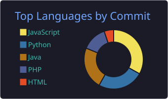

<div align="center">

<!-- HEADER BANNER -->


<p>
  
  
  
  
</p>


**[About](#about) · [Stack](#stack) · [Projects](#projects) · [Analytics](#analytics) · [Learning](#learning) · [Connect](#connect)**

</div>

---

<!-- ABOUT ME SECTION -->
<a id="about"></a>

<table>
<tr>
<td width="56%" valign="top">

### 👨‍💻 About Me

I'm a software engineer who designs and ships end-to-end products — from resilient backend APIs and data pipelines to polished web and mobile interfaces. I care about clean architecture, measurable performance, and code that other people can actually maintain.

```yaml
name:       Brayan Ngowi
handle:     master-bry | BryTheMaster
role:       Software Engineer
location:   Dodoma, Tanzania 🇹🇿
education:  BSc. Software Engineering, UDOM
focus:      Full-Stack · Mobile · Cloud · Data Engineering
status:     Open to new opportunities
```

- 🔭 Currently building with **Java, Spring Boot, React & Flutter**
- 📊 Working across **Big Data pipelines, Analytics & Applied ML**
- 🌱 Deepening **Cloud Architecture, Production ML & Data Engineering**
- 💡 Guiding principle: *clean interfaces, honest metrics, durable systems*
- ⚡ Fun fact: *"Hope keeps us alive, but don't forget to live!"*

</td>
<td width="44%" align="center" valign="top">

<a href="https://daily.dev/masterbry">
  
</a>

<sub>[View dev card →](https://daily.dev/masterbry)</sub>

</td>
</tr>
</table>

---

<a id="stack"></a>
## 🛠️ Technical Arsenal

<details open>
<summary><b>💻 Languages</b></summary>
<br>


</details>

<details open>
<summary><b>⚙️ Backend & APIs</b></summary>
<br>


</details>

<details open>
<summary><b>🎨 Frontend & Mobile</b></summary>
<br>


</details>

<details open>
<summary><b>☁️ Cloud, DevOps & Data Stores</b></summary>
<br>


</details>

<details open>
<summary><b>📊 Data Engineering & Machine Learning</b></summary>
<br>


</details>

<details>
<summary><b>🔧 Tools</b></summary>
<br>


</details>

---

<!-- GITHUB ANALYTICS -->
<a id="analytics"></a>
## 📈 GitHub Analytics

<sub>Generated inside this repository with a token that can read private repositories, so both public and private activity are counted.</sub>

### 🟩 Contribution Graph

<div align="center">
<picture>
  <source media="(prefers-color-scheme: dark)" srcset="https://raw.githubusercontent.com/master-bry/master-bry/output/github-snake-dark.svg?v=1"/>
  
</picture>
</div>

### Profile Summary

<table>
<tr>
<td align="center" width="50%">

</td>
<td align="center" width="50%">

</td>
</tr>
<tr>
<td align="center" width="50%">

</td>
<td align="center" width="50%">

</td>
</tr>
</table>

### 🏅 GitHub Trophies

<div align="center">


</div>

<div align="center">


</div>

<div align="center">

[](https://user-badge.committers.top/tanzania_private/master-bry)

</div>

---

<a id="learning"></a>
## 🌱 Currently Leveling Up

<table>
<tr>
<td width="50%" valign="top">

**☁️ Cloud & Microservices**
> Designing fault-tolerant distributed systems on AWS with Docker and Kubernetes.

**🤖 ML in Production**
> Moving models from notebooks into scalable, monitored production pipelines.

</td>
<td width="50%" valign="top">

**📱 Advanced Mobile Patterns**
> State management, motion design and offline-first architectures in Flutter.

**📈 Big Data Engineering**
> Streaming and batch processing at scale with Spark, Hadoop and real-time pipelines.

</td>
</tr>
</table>

---

<a id="connect"></a>
## 🤝 Let's Connect

<div align="center">

[](https://master-bry.vercel.app)
[](mailto:bryngowi@gmail.com)
[](https://www.linkedin.com/in/brythemaster)
[](https://twitter.com/Master_5326)
[](https://www.instagram.com/bryngowi.161/)
[](https://www.facebook.com/bry5326/)
[](https://stackoverflow.com/users/25196009/brythemaster)
[](https://wa.me/255659864096)

</div>

---

<!-- FOOTER -->


<div align="center">
  <i>"Code is like humor. When you have to explain it, it's bad." — Cory House</i>
</div>
