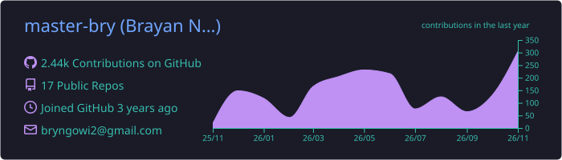
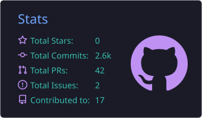
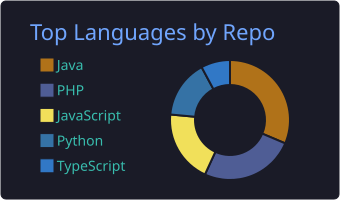

<div align="center">


<p>
  <a href="https://www.linkedin.com/in/brythemaster"></a>
  
  
  
</p>


**[About](#about) · [Stack](#stack) · [Projects](#projects) · [Analytics](#analytics) · [Learning](#learning) · [Connect](#connect)**

</div>

---

<a id="about"></a>

<table>
<tr>
<td width="50%" valign="top">

### 👨‍💻 About Me

I'm a software engineer whose main craft is building **web and mobile applications** — responsive React interfaces, Laravel and Spring Boot APIs, and polished Flutter/Kotlin apps. I care about clean architecture, intuitive UX, maintainable code, and shipping products people actually use. Data engineering is part of my toolkit, used to feed those applications with reliable data.

```yaml
name:       Brayan Ngowi
handle:     master-bry | BryTheMaster
role:       Software Engineer
location:   Dodoma, Tanzania 🇹🇿
education:  BSc. Software Engineering, UDOM
focus:      Web Apps (React · Laravel) · Mobile · Backend APIs
secondary:  Data Engineering · Analytics · Applied ML
status:     Open to new opportunities
```

- 🔭 Currently building web apps with **React, Laravel, TypeScript & Spring Boot**
- 📱 Shipping mobile experiences with **Flutter, React Native & Kotlin**
- 🧩 Designing **REST APIs, authentication flows & clean backend architecture**
- 📊 Supporting work in **data pipelines, analytics & applied ML**
- 💡 Guiding principle: *clean interfaces, honest metrics, durable systems*
- ⚡ Fun fact: *"Hope keeps us alive, but don't forget to live!"*

</td>
<td width="50%" align="center" valign="top">

<a href="https://daily.dev/masterbry">
  
</a>

<sub>[View dev card →](https://daily.dev/masterbry)</sub>

</td>
</tr>
</table>

<div align="center">
  
</div>

---

<a id="stack"></a>
## 🛠️ Technical Arsenal

<details open>
<summary><b>💻 Languages</b></summary>
<br>


</details>

<details open>
<summary><b>🎨 Frontend, Web & Mobile</b></summary>
<br>


</details>

<details open>
<summary><b>⚙️ Backend, APIs & Web Frameworks</b></summary>
<br>


</details>

<details open>
<summary><b>☁️ Cloud, DevOps & Data Stores</b></summary>
<br>


</details>

<details>
<summary><b>📊 Data Engineering & Machine Learning (supporting)</b></summary>
<br>


</details>

<details>
<summary><b>🔧 Tools</b></summary>
<br>


</details>

---

<a id="projects"></a>
## 🚀 Featured Projects

<sub>Mostly apps and websites — React/Laravel web platforms, REST APIs and mobile apps — with data engineering projects as supporting work. Open a card to browse the code and commit history.</sub>

<table>
<tr>
<td width="50%" valign="top" align="center">

**Web Apps, APIs & Mobile (primary focus)**

[](https://github.com/master-bry/ems-frontend)
[](https://github.com/master-bry/finance)
[](https://github.com/master-bry/Nihudumie_App)
[](https://github.com/master-bry/FloodAlertApp)

</td>
<td width="50%" valign="top" align="center">

**Data Engineering & ML (supporting)**

[](https://github.com/master-bry/nyc-taxi-pipeline)
[](https://github.com/master-bry/spark-project)
[](https://github.com/master-bry/fraud-detection-)
[](https://github.com/master-bry/abalone)

</td>
</tr>
</table>

---

<a id="analytics"></a>
## 📈 GitHub Analytics

<sub>Generated inside this repository with a token that can read private repositories, so both public and private activity are counted.</sub>

### 🟩 Contribution Graph

<div align="center">
<picture>
  <source media="(prefers-color-scheme: dark)" srcset="https://raw.githubusercontent.com/master-bry/master-bry/main/assets/github-snake-dark.svg?v=1795532090"/>
  
</picture>

<sub>Contribution activity, including private contributions, rendered as an animated snake.</sub>
</div>

### Profile Summary

<table>
<tr>
<td align="center" width="50%">

</td>
<td align="center" width="50%">

</td>
</tr>
<tr>
<td align="center" width="50%">

</td>
<td align="center" width="50%">

</td>
</tr>
</table>

<sub>Cards are regenerated daily and use the Tokio Night palette to match the profile.</sub>

<div align="center">

[](https://user-badge.committers.top/tanzania_private/master-bry)

</div>

---

<a id="learning"></a>
## 🌱 Currently Leveling Up

<table>
<tr>
<td width="50%" valign="top">

**⚛️ Modern React & Frontend Architecture**
> Component design, state management, TypeScript and performant responsive UIs.

**🐘 Laravel & Backend Craft**
> Eloquent, authentication, REST APIs, queues and testable application structure.

</td>
<td width="50%" valign="top">

**📱 Advanced Mobile Patterns**
> State management, motion design and offline-first architectures in Flutter.

**📊 Data Engineering for Applications**
> Building pipelines and analytics that power product features with Spark and Python.

</td>
</tr>
</table>

---

<a id="connect"></a>
## 🤝 Let's Connect

<div align="center">

[](https://master-bry.vercel.app)
[](mailto:bryngowi@gmail.com)
[](https://www.linkedin.com/in/brythemaster)
[](https://twitter.com/Master_5326)
[](https://www.instagram.com/bryngowi.161/)
[](https://www.facebook.com/bry5326/)
[](https://stackoverflow.com/users/25196009/brythemaster)
[](https://wa.me/255659864096)

</div>

---


<div align="center">
  <i>"Code is like humor. When you have to explain it, it's bad." — Cory House</i>
</div>
