# Theme index

All generated profile card palettes, sorted alphabetically. The profile currently uses [tokyonight](./tokyonight/README.md).

| Theme | Preview |
| --- | --- |
| [2077](./2077/README.md) | 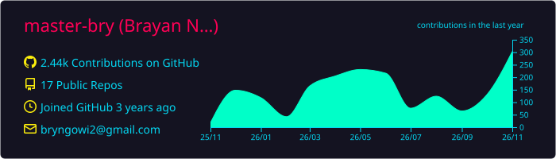 |
| [Algolia](./algolia/README.md) | 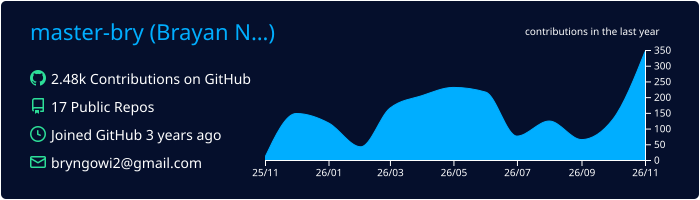 |
| [Apprentice](./apprentice/README.md) | 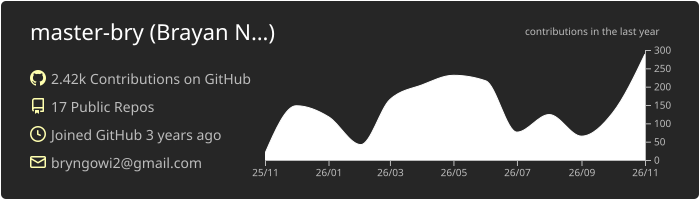 |
| [Aura](./aura/README.md) | 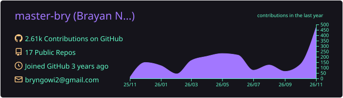 |
| [Aura Dark](./aura_dark/README.md) | 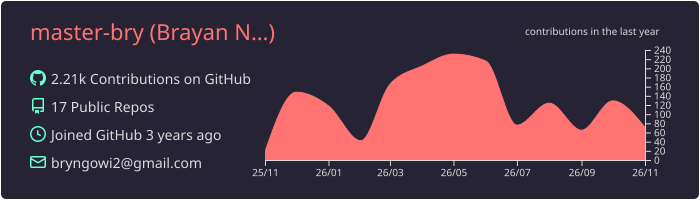 |
| [Ayu Mirage](./ayu_mirage/README.md) | 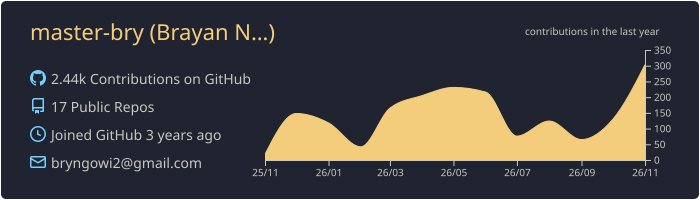 |
| [Bear](./bear/README.md) | 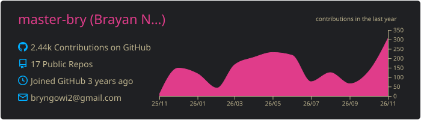 |
| [Blue Green](./blue_green/README.md) | 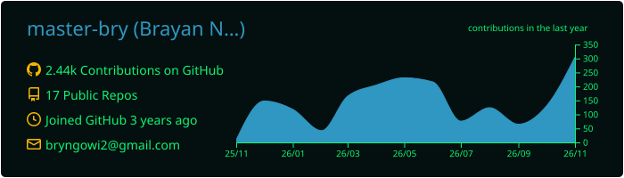 |
| [Blueberry](./blueberry/README.md) | 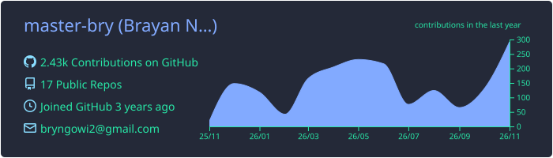 |
| [Buefy](./buefy/README.md) | 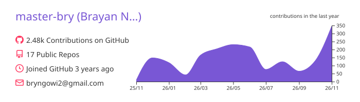 |
| [Calm](./calm/README.md) | 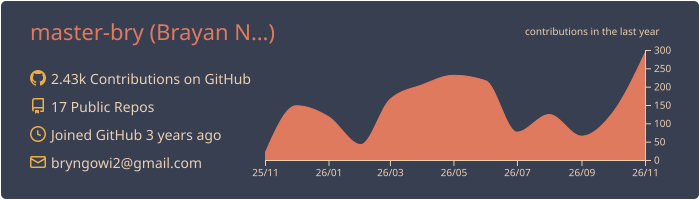 |
| [Chartreuse Dark](./chartreuse_dark/README.md) | 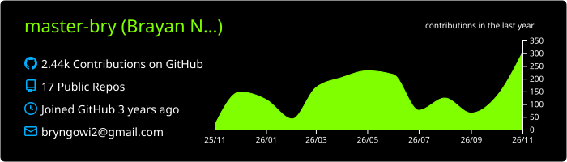 |
| [City Lights](./city_lights/README.md) | 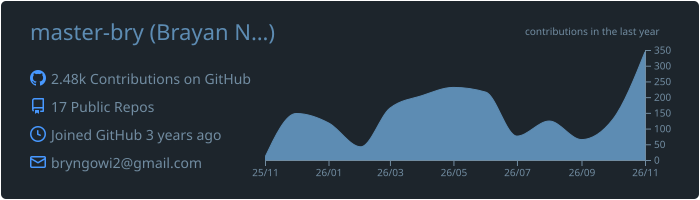 |
| [Cobalt](./cobalt/README.md) | 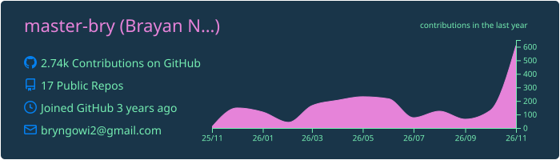 |
| [Cobalt2](./cobalt2/README.md) | 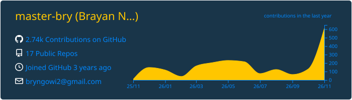 |
| [Codestackr](./codeSTACKr/README.md) | 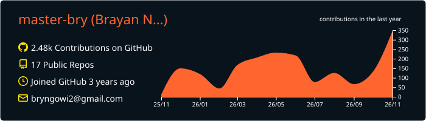 |
| [Darcula](./darcula/README.md) | 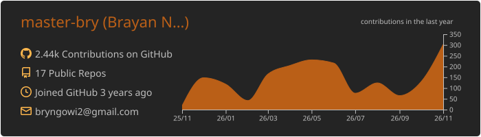 |
| [Dark](./dark/README.md) | 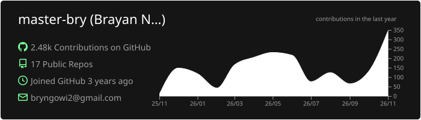 |
| [Date Night](./date_night/README.md) | 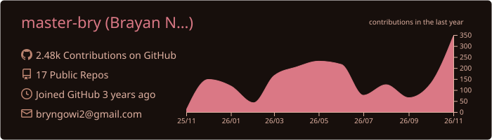 |
| [Default](./default/README.md) | 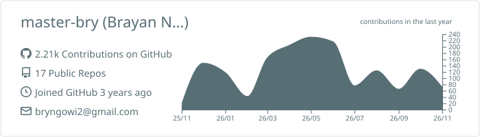 |
| [Discord Old Blurple](./discord_old_blurple/README.md) | 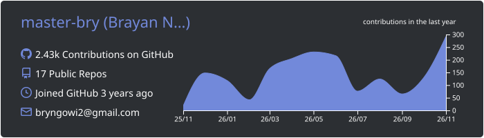 |
| [Dracula](./dracula/README.md) | 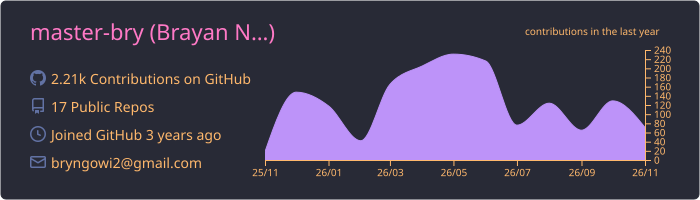 |
| [Flag India](./flag_india/README.md) | 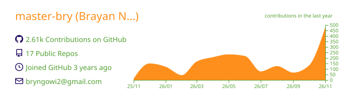 |
| [Github](./github/README.md) | 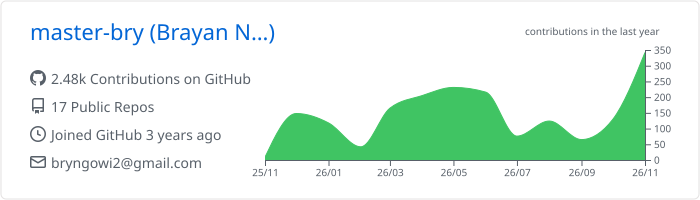 |
| [Github Dark](./github_dark/README.md) | 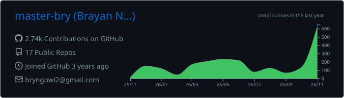 |
| [Gotham](./gotham/README.md) | 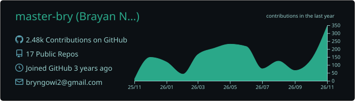 |
| [Graywhite](./graywhite/README.md) | 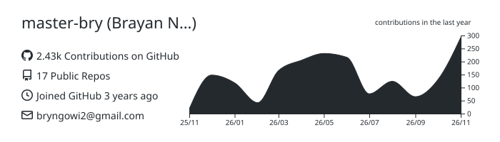 |
| [Great Gatsby](./great_gatsby/README.md) | 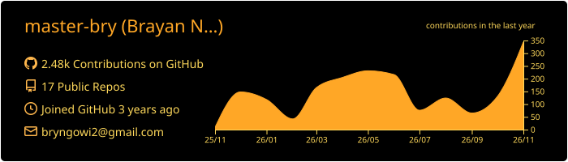 |
| [Gruvbox](./gruvbox/README.md) | 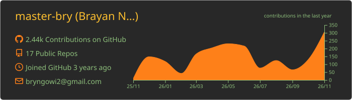 |
| [Highcontrast](./highcontrast/README.md) | 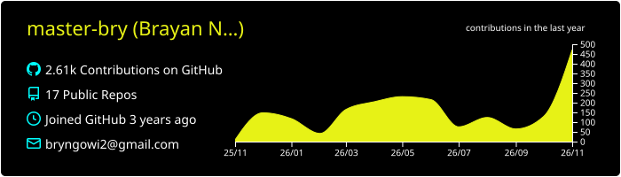 |
| [Holi](./holi/README.md) |  |
| [Jolly](./jolly/README.md) | 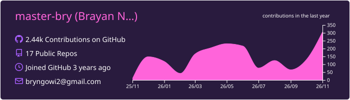 |
| [Kacho Ga](./kacho_ga/README.md) | 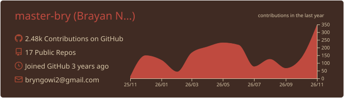 |
| [Maroongold](./maroongold/README.md) | 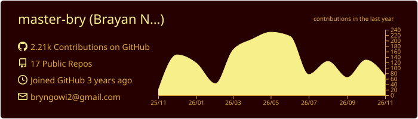 |
| [Material Palenight](./material_palenight/README.md) | 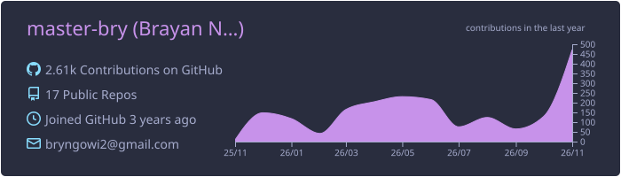 |
| [Merko](./merko/README.md) | 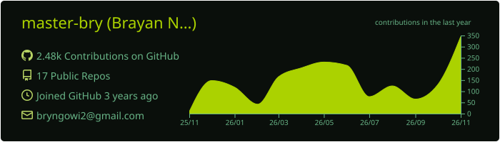 |
| [Midnight Purple](./midnight_purple/README.md) | 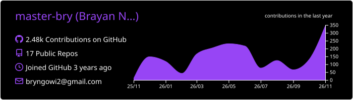 |
| [Moltack](./moltack/README.md) | 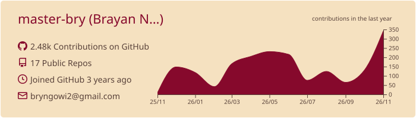 |
| [Monokai](./monokai/README.md) | 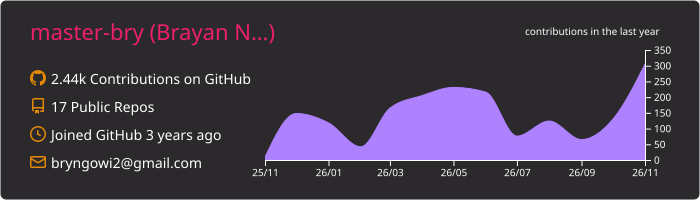 |
| [Moonlight](./moonlight/README.md) | 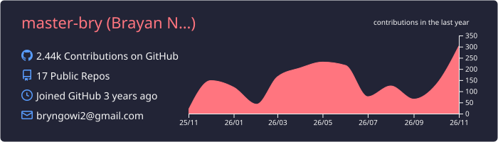 |
| [Nightowl](./nightowl/README.md) | 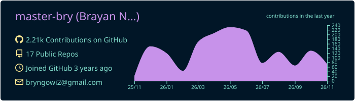 |
| [Noctis Minimus](./noctis_minimus/README.md) | 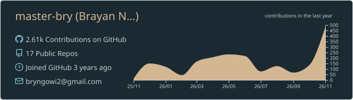 |
| [Nord Bright](./nord_bright/README.md) | 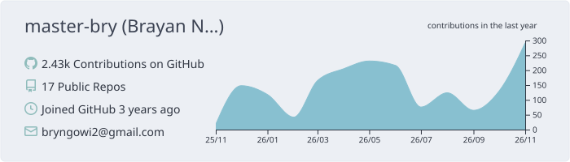 |
| [Nord Dark](./nord_dark/README.md) | 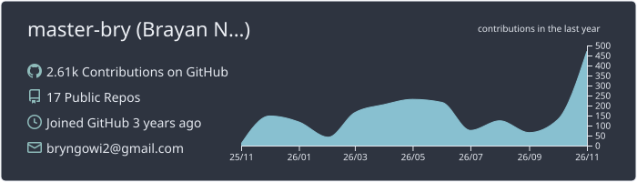 |
| [Ocean Dark](./ocean_dark/README.md) | 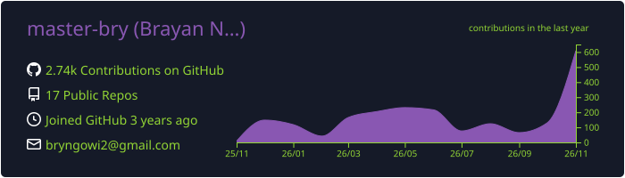 |
| [Omni](./omni/README.md) | 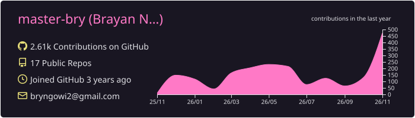 |
| [Onedark](./onedark/README.md) | 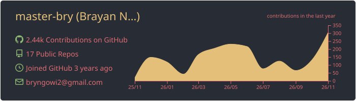 |
| [Outrun](./outrun/README.md) | 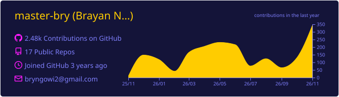 |
| [Panda](./panda/README.md) | 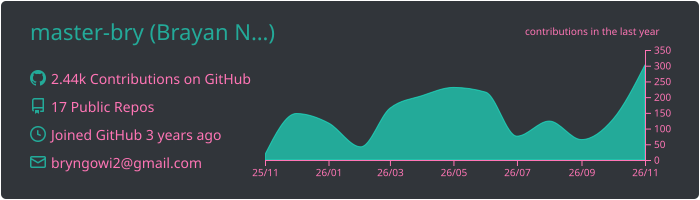 |
| [Prussian](./prussian/README.md) | 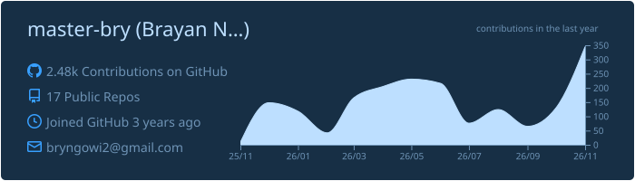 |
| [Radical](./radical/README.md) | 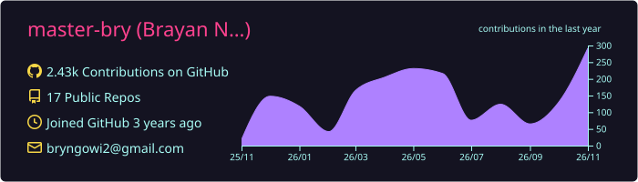 |
| [React](./react/README.md) |  |
| [Rose Pine](./rose_pine/README.md) |  |
| [Shades Of Purple](./shades_of_purple/README.md) |  |
| [Slateorange](./slateorange/README.md) |  |
| [Solarized](./solarized/README.md) |  |
| [Solarized Dark](./solarized_dark/README.md) |  |
| [Swift](./swift/README.md) |  |
| [Synthwave](./synthwave/README.md) |  |
| [Tokyonight](./tokyonight/README.md) |  |
| [Transparent](./transparent/README.md) |  |
| [Vision Friendly Dark](./vision_friendly_dark/README.md) |  |
| [Vue](./vue/README.md) |  |
| [Yeblu](./yeblu/README.md) |  |
| [Zenburn](./zenburn/README.md) |  |

See the [gallery](./README.md) for the original full-size preview grid and [maintenance notes](../docs/CONTRIBUTING.md) for switching themes.
