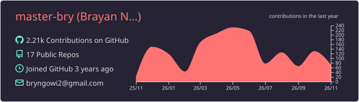
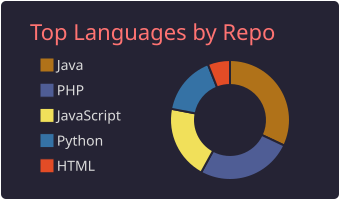
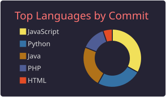
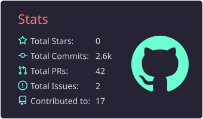
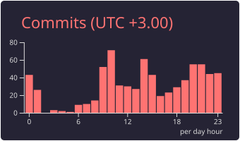

## aura_dark

[All themes](../README.md) · [Theme index](../INDEX.md)

The `aura_dark` palette includes five profile cards: profile details, repositories per language, most committed language, contribution statistics and productive time.

### Preview

[](https://github.com/vn7n24fzkq/github-profile-summary-cards)
[](https://github.com/vn7n24fzkq/github-profile-summary-cards) [](https://github.com/vn7n24fzkq/github-profile-summary-cards)
[](https://github.com/vn7n24fzkq/github-profile-summary-cards) [](https://github.com/vn7n24fzkq/github-profile-summary-cards)
### Copy-ready Markdown
```

[](https://github.com/vn7n24fzkq/github-profile-summary-cards)
[](https://github.com/vn7n24fzkq/github-profile-summary-cards) [](https://github.com/vn7n24fzkq/github-profile-summary-cards)
[](https://github.com/vn7n24fzkq/github-profile-summary-cards) [](https://github.com/vn7n24fzkq/github-profile-summary-cards)

```

### Individual cards
---


```

```

    

---


```

```

    

---


```

```

    

---


```

```

    

---


```

```

---

Back to [all themes](../README.md) or the [theme index](../INDEX.md).
